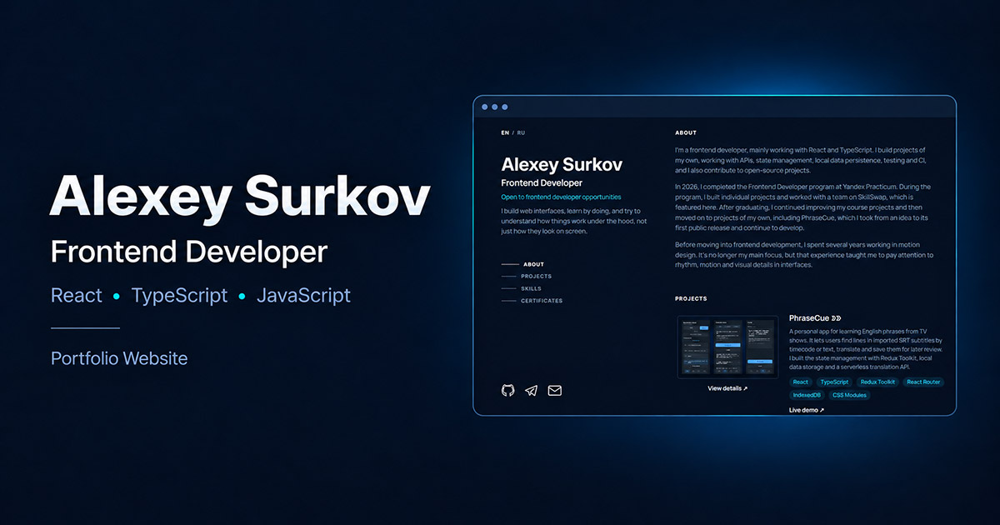

# Portfolio Website

My personal portfolio website built with React, TypeScript and Vite.

It presents my projects, skills and certificates, with English and Russian content, responsive layouts and interaction states for desktop, keyboard and touch devices.

**Live website:** [alexeydev42.com](https://alexeydev42.com/)



## Features

- Responsive layout for desktop, tablet and mobile.
- English and Russian versions with persisted language selection.
- Four featured projects: PhraseCue, SkillSwap, Stellar Burgers and Portfolio Website.
- Dedicated PhraseCue case study with detailed explanations, screenshots and links to the live app and source code.
- Client-side navigation between the main page and the project case study.
- Project and certificate image previews using the native HTML `dialog` element.
- Active section navigation on desktop and sticky section headings on smaller screens.
- Pointer-following spotlight effect on desktop.
- Keyboard focus states, touch-specific interactions and `prefers-reduced-motion` support.
- Page titles and meta descriptions updated based on the current route and language.
- Open Graph and Twitter metadata for social link previews.
- Anonymous, cookie-free traffic statistics with Cloudflare Web Analytics.

## Technical decisions

The site uses React Router with `HashRouter` to support navigation on GitHub Pages without requiring server-side routing configuration.

Portfolio content and the PhraseCue case study are stored as typed data, with separate English and Russian versions. Language selection is managed in React and saved to `localStorage`. The project does not use a global state management library.

CSS Modules are used for component styles, while shared CSS variables define colors, typography, spacing and other design values.

The desktop layout uses two columns with a sticky introduction panel. At smaller widths, it switches to a single-column layout with sticky section headings.

Shared components handle language switching, contact links and image previews. The native HTML `dialog` element is reused for project screenshots, certificates and images within the PhraseCue case study.

Interactive states are adapted for mouse, keyboard and touch input, with reduced-motion preferences respected.

Application tests cover language switching, navigation, page metadata and image previews. GitHub Actions runs linting, formatting checks, tests and the production build.

## Tech stack

- React 19
- TypeScript
- React Router
- Vite
- CSS Modules
- SVGR
- Manrope
- ESLint
- Stylelint
- Prettier
- Vitest
- React Testing Library
- GitHub Actions
- GitHub Pages

## Run locally

Clone the repository and install dependencies:

```bash
git clone https://github.com/alexeydev42/alexeydev42.github.io.git
cd alexeydev42.github.io
npm install
npm run dev
```

## Checks

Run the test suite:

```bash
npm test
```

Run tests in watch mode:

```bash
npm run test:watch
```

Run linting, formatting checks and the production build:

```bash
npm run lint
npm run format:check
npm run build
```

## Deployment

GitHub Actions runs validation on pull requests and pushes to `develop` and `main`.

Changes merged into `main` are automatically built and deployed to GitHub Pages after all checks pass.

**Production:** [alexeydev42.com](https://alexeydev42.com/)
